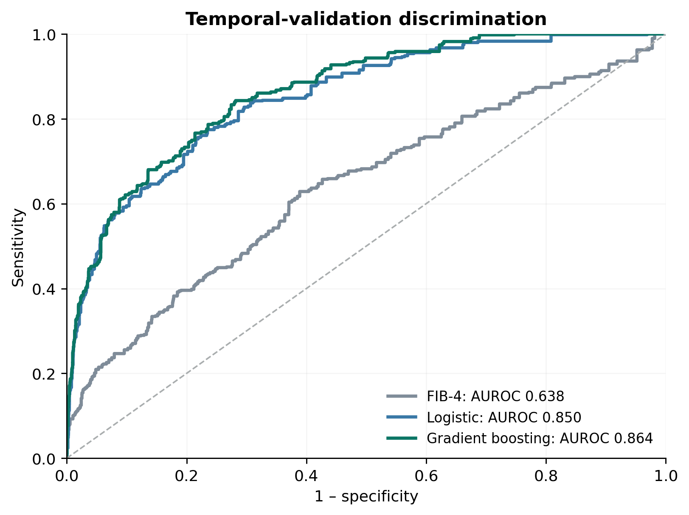
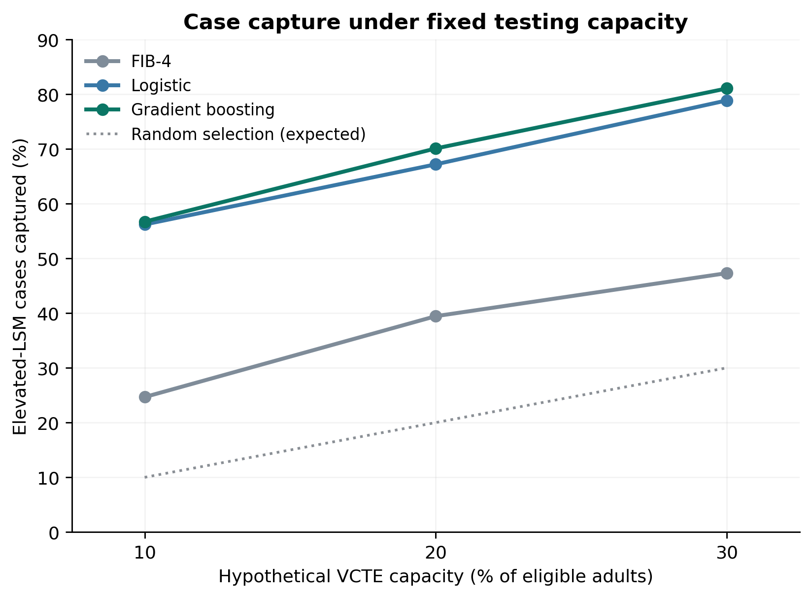

# MASLD-Equity-AI

**Reproducible machine learning for capacity-constrained liver elastography prioritization, temporal validation, and demographic equity audits using public NHANES data.**

[](https://www.python.org/)
[](LICENSE)
[](https://wwwn.cdc.gov/nchs/nhanes/)
[](#manuscript-and-citation)

This repository accompanies the research manuscript:

> **Beyond Predictive Accuracy: Interpretable and Equity-Audited Machine Learning for Capacity-Constrained Liver Elastography in Adults at Risk of MASLD: A Temporal NHANES Study**  
> *Original research manuscript under preparation for BioMedInformatics.*  
> Francesco Branda and collaborators. **Final author list and bibliographic citation pending author confirmation.**

The research question is not simply whether machine learning has a higher AUROC than FIB-4. It asks: **at a fixed hypothetical elastography capacity, which prioritization strategy identifies more people with elevated liver stiffness, and how are referrals distributed across population subgroups?**

## Study at a glance

| Characteristic | Development | Temporal validation |
|:--|--:|--:|
| NHANES release | 2017–March 2020 | August 2021–August 2023 |
| Eligible adults at metabolic risk | 5,604 | 3,736 |
| Participants with liver stiffness >=12 kPa | 229 | 206 |

**Primary endpoint:** vibration-controlled transient elastography liver stiffness >=12 kPa. This is a *non-histological marker of elevated liver stiffness*, **not** biopsy-confirmed advanced fibrosis. Metabolic-risk eligibility is **not** a verified MASLD diagnosis.

### Temporal validation: discrimination

| Model / score | Survey-weighted AUROC |
|:--|--:|
| FIB-4 | **0.638** |
| Penalized logistic regression | **0.850** |
| Calibrated gradient boosting | **0.864** |

### Hypothetical 20% VCTE testing capacity

| Prioritization rule | Elevated-LSM cases captured |
|:--|--:|
| FIB-4 ranking | **39.4%** |
| Penalized logistic regression | **67.2%** |
| Calibrated gradient boosting | **70.1%** |

Gradient boosting versus FIB-4: **+30.6 percentage points** in case capture (approximate 95% stratified PSU bootstrap interval **+27.0 to +35.7 percentage points**). This is a *retrospective allocation simulation*, not a prospective demonstration of clinical benefit or real-world access to VCTE.

## Figures

| Discrimination | Capacity-constrained referral |
|:--:|:--:|
|  |  |

All six generated figures are in [`figures/`](figures/): cohort selection, ROC curves, calibration, capacity-constrained case capture, demographic referral distribution, and permutation importance.

## Reproduce the analysis

**Prerequisites:** Python >=3.11, `pip`, and internet access to CDC for the original 14 NHANES SAS XPT files (or place the source files manually in `data/`). No participant-level data are included in this repository.

```bash
git clone https://github.com/YOUR_USERNAME/MASLD-Equity-AI.git
cd MASLD-Equity-AI
python -m venv .venv
source .venv/bin/activate
python -m pip install -r requirements.txt
sh run_all.sh
```

Replace `YOUR_USERNAME` with the GitHub account hosting this project once the repository is published. On Windows, activate the virtual environment using `.venv\Scripts\activate` in a suitable shell; the provided `run_all.sh` requires a POSIX-compatible shell.

The pipeline automatically attempts to download missing public XPT files from the official CDC URLs; see [`docs/DATA_FILES.txt`](docs/DATA_FILES.txt). If automatic download is unavailable, manually save all 14 XPT files in `data/` and rerun. The script then creates:

- `results/results.json`: population counts, weighted metrics, bootstrap intervals, capacity policies, and exploratory subgroup comparisons.
- `results/validation_predictions.csv`: locally generated participant-level scores, **ignored by Git** and not meant for upload.
- `results/fig*.png`: regenerated figure images.
- `BioMedInformatics_MASLD_Reproduced_Manuscript.docx`: a generated manuscript draft, **ignored by Git** pending author verification.

For detailed inputs and statistical limitations, see [`docs/METHODS_AND_LIMITATIONS.md`](docs/METHODS_AND_LIMITATIONS.md) and [`docs/REPRODUCIBILITY.md`](docs/REPRODUCIBILITY.md).

### Verify repository outputs

```bash
python -m unittest discover -s tests -v
python -m compileall -q scripts
```

The checks validate the structure and internal consistency of the **committed aggregate summary**, but are not a substitute for independently rerunning the pipeline against CDC records.

## Project structure

```text
MASLD-Equity-AI/
├── README.md
├── CITATION.cff
├── LICENSE
├── requirements.txt
├── run_all.sh
├── scripts/
│   ├── run_analysis.py
│   ├── augment_analysis.py
│   ├── make_figures.py
│   └── build_full_paper.py
├── figures/                  # Six figures from observed NHANES analyses
├── results/
│   └── results.json          # Aggregate outcomes only
├── docs/
│   ├── DATA_FILES.txt
│   ├── XPT_SHA256_AS_UPLOADED.txt
│   ├── METHODS_AND_LIMITATIONS.md
│   └── REPRODUCIBILITY.md
├── tests/
│   └── test_results.py
└── .github/workflows/validate.yml
```

## Important scientific qualifications

- The study involves **adults at metabolic risk of MASLD**, not a cohort with adjudicated MASLD.
- LSM >=12 kPa is a **surrogate** outcome. It does not establish histological fibrosis stage.
- Predicted probabilities may be undercalibrated when transported between survey periods.
- ML models use more features than FIB-4, so the ranking comparison does not isolate algorithm effects from additional data inputs. A reduced-feature sensitivity analysis addresses part of this concern.
- Referral capacity is **hypothetical** (10%, 20%, 30%); no observed clinical capacity, treatment effect, economic saving, or equitable clinical outcome has been estimated.
- Bootstrap confidence limits are approximate, conditional on fixed validation predictions, and do not incorporate full model-development uncertainty.
- Subgroup differences are exploratory, and small event counts limit interpretation. No claim of proven fairness improvement is made.

Please read the [complete methodological notes](docs/METHODS_AND_LIMITATIONS.md) before interpreting or reusing the outputs.

## Data availability

Underlying public-use NHANES datasets are available from the [National Center for Health Statistics](https://wwwn.cdc.gov/nchs/nhanes/). We do **not** redistribute the original XPT records or locally generated participant-level predictions. [`docs/XPT_SHA256_AS_UPLOADED.txt`](docs/XPT_SHA256_AS_UPLOADED.txt) records SHA-256 hashes of the 14 input files supplied for this analysis; these are provenance fingerprints, **not** independently certified CDC checksums.

## Manuscript and citation

Research manuscript preparation and authorship verification are ongoing. No DOI, publication date, article acceptance, or journal endorsement is claimed. GitHub automatically exposes a **Cite this repository** control using [`CITATION.cff`](CITATION.cff). Update the citation and associated article URL after publication.

## Reuse, attribution and AI disclosure

Code is shared under the [MIT License](LICENSE). The repository was assembled with AI assistance, including Python code and English drafting assistance from OpenAI ChatGPT (GPT-6); all reported numerical estimates are derived from program execution on actual public-use NHANES files, not generated as illustrative data. The research authors remain responsible for independent verification of analytic methods, source references, estimates, and reporting before submission or reuse. This repository is research software and is **not a clinical decision-support device**.
